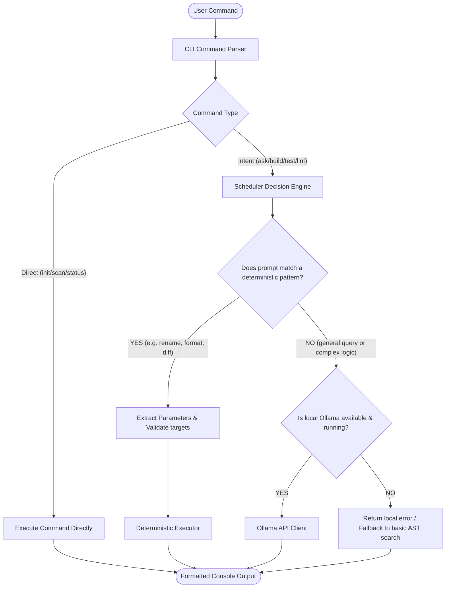
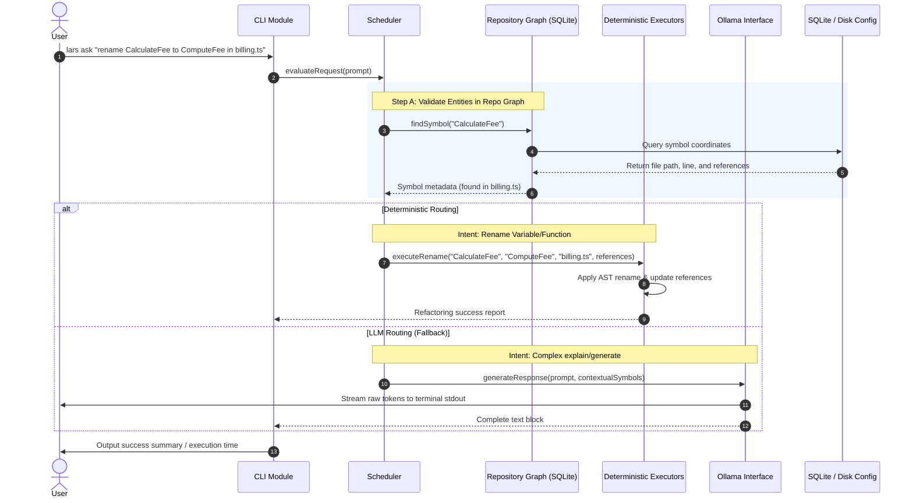

# LARS (Local Agent Reasoning Scheduler) — Phase 1 Architecture Design

This document details the architectural specification for Phase 1 of the **LARS (Local Agent Reasoning Scheduler)**, a lightweight, CPU-efficient developer tool designed to run locally on resource-constrained hardware (e.g., Dell Inspiron 3535, AMD Ryzen 5 CPU, 8 GB RAM, CPU-only, offline Linux).

---

## 1. Recommended Project Folder Structure

A flat, modular layout is chosen to minimize file system traversal overhead and enable simple imports without deep relative path resolutions.

```
lars/
├── bin/
│   └── lars.js                 # executable entry point (shebang wrapper)
├── src/
│   ├── cli/
│   │   ├── args.ts             # zero-dependency CLI argument parser
│   │   └── commands.ts         # command handlers (init, scan, ask, build, etc.)
│   ├── scheduler/
│   │   ├── router.ts           # deterministic vs. LLM decision router
│   │   └── rules.ts            # regex and keyword pattern matching rules
│   ├── graph/
│   │   ├── scanner.ts          # incremental repo scanner
│   │   ├── parser.ts           # tree-sitter or regex-based code symbol extractor
│   │   └── db.ts               # SQLite database access layer (symbol index)
│   ├── executors/
│   │   ├── index.ts            # executor registry
│   │   ├── ast.ts              # AST refactoring & token modifications
│   │   ├── fs.ts               # filesystem operations (create, move, delete)
│   │   ├── process.ts          # process spawner (build, test, lint, format)
│   │   └── git.ts              # git integration (status, diff)
│   ├── ollama/
│   │   └── client.ts           # lightweight HTTP wrapper for Ollama API
│   ├── logger/
│   │   └── json_log.ts         # high-performance JSON-line logger
│   ├── config.ts               # global settings and state configuration
│   └── index.ts                # library entry point
├── tests/
│   ├── scheduler.test.ts
│   ├── scanner.test.ts
│   └── executors.test.ts
├── package.json                # package metadata and minimal scripts
├── tsconfig.json               # typescript build settings
└── esbuild.config.js           # bundling configuration
```

---

## 2. Responsibilities of Each Folder

| Folder | Module / File | Core Responsibility | CPU / RAM Optimization Guardrails |
| :--- | :--- | :--- | :--- |
| **`cli/`** | CLI Interface | Parses CLI parameters, routes to command handlers, outputs structured text to stdout/stderr. | Uses a custom `args.ts` parser instead of heavy CLI frameworks (like Commander or Yargs) to reduce startup time. |
| **`scheduler/`** | Reasoning Scheduler | Implements the decision engine. Decides if a request can be fulfilled using deterministic executors or requires Ollama. | Implements a fast compiled regex and rule lookup tree. Zero AI/ML overhead. Runs in micro-seconds. |
| **`graph/`** | Repository Graph | Scans code directories recursively, extracts imports, exports, functions, classes, and saves them in SQLite. | Uses incremental updates based on file modified times (`mtime`). Never parses unchanged files. |
| **`executors/`** | Deterministic Executors | Interfaces with the local environment. Edits files via AST, renames symbols, and runs shell tasks. | Uses streaming file reads/writes. Spawns tasks as lightweight child processes with buffered outputs. |
| **`ollama/`** | Ollama Client | Manages model presence detection and handles HTTP requests/responses to local Ollama service. | Leverages Ollama's local server; does not bundle an LLM engine. Uses streaming HTTP responses to lower heap memory. |
| **`logger/`** | Logger | Appends lightweight execution logs to a local JSONL or SQLite file. | Uses synchronous/buffered appends to prevent file locking overhead and write bloat. |

---

## 3. Overall Execution Flow

LARS enforces a **deterministic-first** execution lifecycle. Every prompt or command is filtered through deterministic pathways to bypass expensive model inference whenever possible.



---

## 4. Data Flow Between Modules



---

## 5. Scheduler Decision Flow

The LARS Scheduler uses a prioritized **Confidence-and-Rule-Based Routing Tree**:

1. **Step 1: Prefix / Keyword Extraction**
   * Parse the user query for command signatures:
     * `rename <X> to <Y>`
     * `format`
     * `move <X> to <Y>`
     * `run build` / `run test` / `run lint`
2. **Step 2: Intent Pattern Check**
   * Match user queries against pre-compiled Regular Expression trees.
   * If a match occurs, extract targets (e.g., source code symbol names, files).
3. **Step 3: Graph Verification**
   * Query the lightweight SQLite graph database:
     * Does the target file exist?
     * Does the target symbol exist in the graph?
   * If verification succeeds, confidence is **High (1.0)**. Route directly to the corresponding **Deterministic Executor**.
4. **Step 4: LLM Abstraction Fallback**
   * If no pattern matches, or validation fails (e.g., the target file is missing, or query asks "why" or "how"), route to the **Ollama Interface** with context injected from the SQLite graph.

---

## 6. Minimal Technology Stack

To guarantee fast execution on the AMD Ryzen 5 with 8GB RAM under Ubuntu Linux, the technology stack is constrained to:

1. **Runtime**: **Node.js (LTS version 20+)**
   * *Justification*: Low resource baseline when optimized, native to VS Code integration, extremely fast startup (~30ms) when dependencies are bundled and minimized.
2. **Language**: **TypeScript**
   * *Justification*: Strict compilation ensures safety for AST modifications while maintaining readability.
3. **Database**: **SQLite3 (via `better-sqlite3` or native node-sqlite binding)**
   * *Justification*: Serverless, single C-level library with zero background memory footprints. Fast indexed lookups.
4. **Bundler**: **esbuild**
   * *Justification*: Bundles the TS source and tree-shakes unused nodes into a single lightweight execution bundle (`dist/lars.js`), reducing file system reading overhead.
5. **AST Parser**: **`tree-sitter` (via `web-tree-sitter` or node-bindings)**
   * *Justification*: Highly optimized, incremental C-based parsing. Emits AST quickly with tiny memory footprint. Supported extensions cover TS/JS, Python, and C/C++.

---

## 7. Dependency List with Justification

Keeping the production bundle lightweight is crucial. Only 3 direct runtime dependencies are proposed:

| Dependency | Purpose | Justification for Inclusion |
| :--- | :--- | :--- |
| **`better-sqlite3`** | Storage and Indexing | The fastest SQLite wrapper for Node.js. Sync execution avoids microtask loop overhead, maximizing throughput on low-thread counts. |
| **`web-tree-sitter`** | AST Parsing | WebAssembly/C binary AST parser. Uses minimal CPU cycles, supports incremental tree modifications, and does not require heavy native compiler chains during npm install. |
| **`undici`** *(or native fetch)* | Ollama HTTP Requests | Native Node.js request wrapper. Low overhead HTTP/1.1 and HTTP/2 clients to stream prompts and receive chunked responses. |

### Development Dependencies (Not shipped in production binary):
* `typescript` - compile-time type validation.
* `esbuild` - tree-shaking compilation.
* `jest` or `node:test` - unit testing frameworks.

---

## 8. Suggested File Naming Conventions

* **Source Files**: Lowercase kebab-case (`symbol-scanner.ts`, `ast-executor.ts`).
* **Test Files**: Match source naming, appended with `.test.ts` (e.g., `ast-executor.test.ts`).
* **Interfaces / Types**: Prefixed with `I` (e.g., `IScheduler.ts`) or exported directly in a common types file (`types.ts`).
* **Database migrations**: ISO date prefixes (`20260712-init-schema.sql`).

---

## 9. Development Roadmap for Phase 1

```
┌──────────────────────────────────────────────────────────┐
│ PHASE 1: FOUNDATION DEVELOPMENT (Est: 3 Weeks)           │
└──────────────────────────────────────────────────────────┘
                         │
                         ▼
┌──────────────────────────────────────────────────────────┐
│ WEEK 1: Core CLI & Database Schema Setup                 │
│ 1. Initialize TypeScript boilerplate & esbuild config.    │
│ 2. Build zero-dependency argument parser (args.ts).      │
│ 3. Create SQLite schema for symbols, imports, and log.   │
└──────────────────────────────────────────────────────────┘
                         │
                         ▼
┌──────────────────────────────────────────────────────────┐
│ WEEK 2: Scanner & Deterministic Executors                 │
│ 1. Write file crawler (scanner.ts) with mtime cache.     │
│ 2. Integrate web-tree-sitter to index imports & classes. │
│ 3. Implement AST refactoring tools and runner actions.   │
└──────────────────────────────────────────────────────────┘
                         │
                         ▼
┌──────────────────────────────────────────────────────────┐
│ WEEK 3: Scheduler, Ollama & Log integration              │
│ 1. Design rule router & keyword extraction engine.       │
│ 2. Build Ollama API connector & streaming output.        │
│ 3. Integrate JSONL/SQLite logging. Test end-to-end flow.  │
└──────────────────────────────────────────────────────────┘
```

---

## 10. Architectural Rationale: CPU, RAM, & Offline-First

### A. Maximizing CPU Efficiency (Inference Mitigation)
* **LLM Bypass**: Ollama/LLM inference utilizes 100% of all available CPU cores when run on CPU-only. By forcing common tasks (rename, format, build, status checks) down deterministic code paths, CPU utilization drops to virtually **0%** for 90% of a developer's daily operations.
* **No Embeddings / Vector Databases**: Embedding generation is extremely resource-intensive on CPUs. LARS avoids vector lookups completely, substituting them with structured SQL indexes over extracted symbols.

### B. Minimizing RAM Usage
* **Single-Process SQLite**: Vector databases (like ChromaDB, Qdrant) or heavy search servers run as separate processes requiring 200MB - 1GB of resident memory. SQLite operates in-process, using only 5-15MB of RAM for caching indexing trees.
* **Incremental AST Parsing**: Instead of parsing the entire project into memory, the Repository Graph parses files incrementally. If a file's hash or write time matches the SQLite index, LARS skips it.

### C. Maintainability & VS Code Extension Target
* **Node.js Alignment**: Since VS Code Extensions are written in TypeScript/JavaScript, writing LARS in TypeScript ensures that the CLI code can later be integrated directly into a VS Code extension bundle, or run as a lightweight workspace child process.
* **Separation of Concerns**: Executors have zero knowledge of Ollama, and Ollama is completely decoupled from the CLI. This ensures developers can swap Ollama for another local client (like llama.cpp) without editing CLI syntax or AST parser rules.

### D. Offline-First Operation
* **Local HTTP Boundary**: The Ollama abstraction targets `localhost:11434` exclusively. There is no telemetry, no cloud network checks, and no dynamic asset loading. The scanner works strictly on the local workspace directory.
