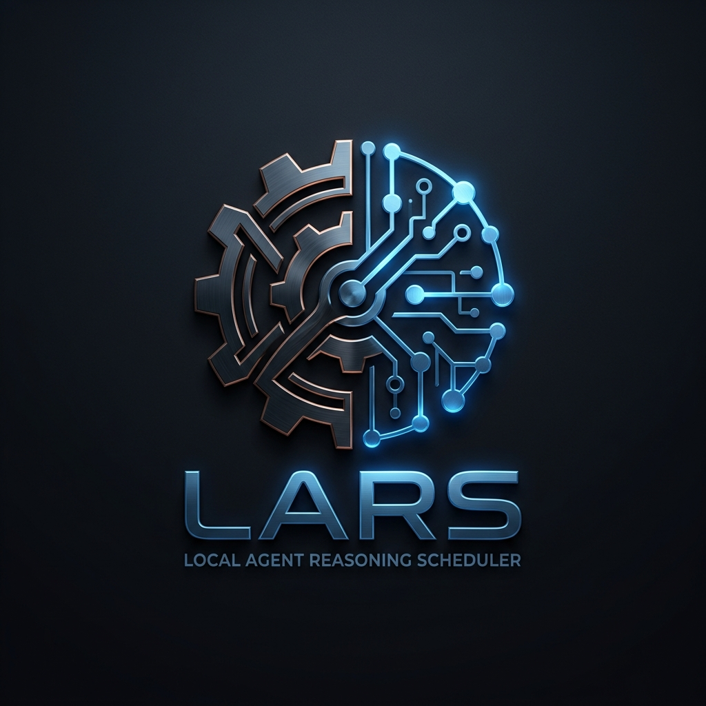
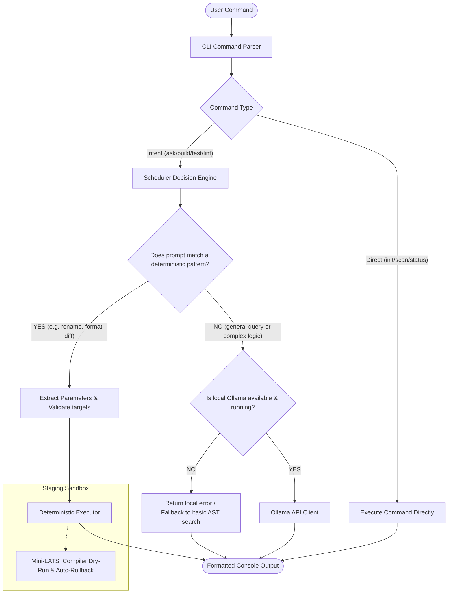

# LARS — Local Agent Reasoning Scheduler

[](https://github.com/gaurish676/LLM-PRG/actions)
[](LICENSE)
[](package.json)
[](CONTRIBUTING.md)

LARS (Local Agent Reasoning Scheduler) is a lightweight, CPU-efficient, offline-first developer tool designed to bridge the developer and local Small Language Models (SLMs). LARS acts as an intelligent reasoning router, intercepting requests and using high-confidence deterministic execution paths whenever possible to bypass expensive model inference.

<p align="center">
  
</p>

---

## 📖 Table of Contents
1. [Problem Statement](#-problem-statement)
2. [Key Features](#-key-features)
3. [Architecture Overview](#-architecture-overview)
4. [Workflow & Execution Sequence](#-workflow--execution-sequence)
5. [Technology Stack](#-technology-stack)
6. [Project Structure Tree](#-project-structure-tree)
7. [Installation & Prerequisites](#-installation--prerequisites)
8. [Configuration & Environment](#-configuration--environment)
9. [Usage Guide](#-usage-guide)
10. [Example Outputs](#-example-outputs)
11. [API Documentation](#-api-documentation)
12. [Development & Test Workflow](#-development--test-workflow)
13. [Limitations & FAQ](#-limitations--faq)
14. [Future Improvements](#-future-improvements)
15. [Contributing](#-contributing)
16. [License](#-license)

---

## 🔍 Problem Statement

Local development with large models poses significant challenges on consumer-grade hardware (e.g., CPU-only environments with 8GB RAM):
* **Inference Overhead**: Spawning language models for simple operations (e.g., renaming symbols, formatting files, running tests) utilizes 100% CPU/GPU cores and drains batteries.
* **Context Prefill Latency**: Passing entire source code structures into LLM prompts consumes large amounts of memory and creates massive execution delays.
* **Lack of Safety**: AI agents modifying files directly can introduce compilation errors, syntax breaks, or leak files beyond the project boundaries.

LARS solves this by introducing a **deterministic-first execution lifecycle**. It classifies prompts and implements a confidence-based router. If the operation can be completed deterministically (e.g., AST refactoring, code formatting, running build checks), it runs in milliseconds under **0% AI overhead**, falling back to local SLMs (such as Qwen-2.5-Coder) only when conceptual queries or complex code generation are requested.

---

## ✨ Key Features

* **Confidence-Based Routing Engine**: Uses regex and pattern matching to classify developer intent (rename, clear, format, build, test, etc.). Calculates confidence scores to route to C-level deterministic executors or local SLMs.
* **Mini-LATS Safe Execution Broker**: Implements safety validation hooks. Creates a temporary backup before any file modifications and runs a compilation dry-run (`tsc --noEmit`). On failure, LARS rolls back the workspace automatically to maintain code health.
* **Sandbox Containment Guard**: Restricts all crawling, file edits, and process executions strictly inside the current workspace directory, triggering an immediate kernel abort if any path escapes.
* **Incremental Workspace Scanner**: Crawls directories recursively and parses code symbols (classes, interfaces, functions, consts) incrementally, keeping search indexes synchronized.
* **Context Compression Preprocessor**: Searches prompt tokens and fetches matched symbol definitions from the local symbol registry, compiling a highly condensed prompt context that reduces LLM prefill tokens by ~90%.
* **Stateful TUI Chat Shell**: Built-in interactive REPL shell (`lars chat`) using Node.js readline with colored text styling, active module tracking, and session memory.
* **Volatile Memory Journal**: Uses a compact JSON-based journal (`.lars/lars.journal`) under 2KB for stateless CLI run state tracking across terminal invocations.

---

## 🏗️ Architecture Overview

The system operates across four primary modules:



---

## 🔄 Workflow & Execution Sequence

When the scheduler routes a conceptual query to the SLM, LARS runs a sequence diagram layout to compress prompt context and stream response blocks:

```mermaid
sequenceDiagram
    autonumber
    actor User
    participant CLI as CLI Module
    participant SCHED as Scheduler
    participant GRAPH as Repository Graph
    participant EXEC as Deterministic Executors
    participant OLLAMA as Ollama Interface
    
    User->>CLI: lars ask "rename CalculateFee to ComputeFee in billing.ts"
    CLI->>SCHED: evaluateRequest(prompt)
    
    rect rgb(20, 24, 33)
        Note over SCHED, GRAPH: Step A: Validate Entities in Repo Graph
        SCHED->>GRAPH: findSymbol("CalculateFee")
        GRAPH-->>SCHED: Symbol metadata (found in billing.ts)
    end

    alt Deterministic Routing
        Note over SCHED, EXEC: Intent: Rename Variable/Function
        SCHED->>EXEC: executeRename("CalculateFee", "ComputeFee", "billing.ts")
        EXEC->>EXEC: Apply AST regex rename
        EXEC->>EXEC: Run compiler test (npx tsc --noEmit)
        alt Compiler OK
            EXEC-->>CLI: Success report
        else Compiler Error
            EXEC->>EXEC: Restore backup file state
            EXEC-->>CLI: Rollback warning / Failure
        end
    else LLM Routing (Fallback)
        Note over SCHED, OLLAMA: Intent: Complex explain/generate
        SCHED->>OLLAMA: generateResponse(prompt, contextualSymbols)
        OLLAMA->>User: Stream raw tokens to terminal stdout
        OLLAMA-->>CLI: Complete text block
    end
    
    CLI->>User: Output success summary / execution time
```



---

## 🛠️ Technology Stack

LARS is built for extreme lightweight execution on local hardware:
* **Runtime**: **Node.js (LTS v20+)** (minimizes resource baseline; fast startup time of ~30ms).
* **Language**: **TypeScript 7.0+** (strict compilation checks for AST modifications).
* **Code Formatting**: **Prettier** (automated code styling rules).
* **CLI Library**: Zero-dependency custom parser in `src/cli/args.ts` to prevent runtime loading bottlenecks.
* **Local SLM**: **Ollama** running `qwen2.5-coder:1.5b` (approx. 900MB memory footprint, highly optimized for coding tasks).

---

## 📂 Project Structure Tree

```text
LLM-PRG/
├── .github/
│   ├── ISSUE_TEMPLATE/        # GitHub issue structures
│   ├── workflows/             # GitHub CI configuration
│   └── PULL_REQUEST_TEMPLATE  # Pull Request rules
├── assets/
│   └── logo.jpg               # Visual brand asset
├── src/
│   ├── cli/
│   │   ├── args.ts            # High-performance zero-dependency arguments parser
│   │   ├── commands.ts        # Command dispatcher & executor handlers
│   │   └── tui.ts             # TUI terminal formatting colors and layouts
│   ├── core/
│   │   └── memory/
│   │       └── journal.ts     # Volatile <2KB state journal
│   ├── graph/
│   │   └── db.ts              # In-memory symbol database crawling classes/functions
│   ├── ollama/
│   │   └── client.ts          # HTTP request streams connecting local Ollama service
│   ├── scanner/
│   │   ├── lexer.ts           # Balanced brackets lexical analyzer
│   │   └── walker.ts          # Asynchronous lazy directory tree crawler
│   ├── scheduler/
│   │   ├── agents.ts          # Specialist agent persona registers
│   │   ├── classifier.ts      # Structured command parser
│   │   ├── engine.ts          # Intent score confidence router
│   │   ├── planner.ts         # Multi-step command decomposing planner
│   │   └── preprocessor.ts    # Prompt context compiler & compressor
│   ├── utils/
│   │   ├── io.ts              # Workspace sandboxed folder generators
│   │   └── sandbox.ts         # Containment sandbox guard
│   ├── config.ts              # System configuration configurations
│   ├── index.ts               # CLI executable shebang entry point
│   └── main.ts                # Application main loop controller
├── tests/
│   ├── journal.test.ts        # Benchmarking test cases
│   ├── runner.ts              # Test suite automation runner
│   ├── sandbox-abort.test.ts  # Verification test for sandbox boundary escapes
│   ├── step3.test.ts          # Lexer streaming parser test
│   ├── step4.test.ts          # Planner & routing engine test
│   ├── step5.test.ts          # Preprocessor and LLM offline mock test
│   └── step6.test.ts          # Pronoun resolution parser test
├── users_io/                  # Sandboxed folder for local response inputs/outputs
│   ├── input/
│   └── output/
├── .editorconfig              # Code editor formatting rules
├── .gitattributes             # Git LF line normalization rules
├── .gitignore                 # Track exclusions configuration
├── package.json               # NPM configuration and dependencies
└── tsconfig.json              # TypeScript compilation configuration
```

---

## 🚀 Installation & Prerequisites

### Prerequisites
* **Node.js** (v20.0.0 or higher)
* **npm** (v10.0.0 or higher)
* **Ollama** (optional, for local LLM reasoning)

### Setup Guide
1. Clone the repository:
   ```bash
   git clone https://github.com/gaurish676/LLM-PRG.git
   cd LLM-PRG
   ```
2. Install dependencies:
   ```bash
   npm install
   ```
3. Compile/Build the project:
   ```bash
   npm run build
   ```
4. Set up local Small Language Model (SLM) offline using the installer:
   ```bash
   chmod +x setup-slm.sh
   ./setup-slm.sh
   ```

---

## ⚙️ Configuration & Environment

LARS operates out of the box with zero external configuration requirements. It stores configuration metadata inside `.lars/`:
* `.lars/lars.journal`: Volatile state tracker (<2KB).
* `.lars/symbols.json`: JSON cache of code symbols extracted during scans.
* `.lars/summary.json`: Project status, scan time, and build compilation histories.

---

## 💻 Usage Guide

LARS can be run as a single CLI execution block or in an interactive chat shell.

### Executable Link
Make LARS globally available on your terminal:
```bash
npm link
# Or run using path references
./lars <command>
```

### Core CLI Commands

* **Initialize a workspace**:
  ```bash
  lars init
  ```
* **Scan workspace for symbols**:
  ```bash
  lars scan
  ```
  Use `--quick` or `-q` to bypass directory trees and scan only the currently active module:
  ```bash
  lars scan --quick
  ```
* **Status dashboard**:
  ```bash
  lars status
  ```
* **Deterministic or Conceptual Queries**:
  ```bash
  lars ask "rename CalculateFee to ComputeFee in src/billing.ts"
  lars ask "Explain how the symbols database works?"
  ```
* **Interactive TUI Chat Shell**:
  ```bash
  lars chat
  ```
* **Run compilations, testing, or lint checks**:
  ```bash
  lars build
  lars test
  lars lint
  ```

---

## 📊 Example Outputs

### TUI Chat Interface (`lars chat`)
```text
  LARS (Local Agent Reasoning Scheduler) — CLI Backend
   Commands: status, scan, build, test, lint, init
   Prompts: Natural language queries (e.g. "create file test.py")
   Exit: Type 'exit', 'quit', or Ctrl+C to terminate.

LARS ❯ scan
Scanning workspace index...
Indexing 14 file(s)...
Successfully indexed 42 symbol declarations.
Workspace scan complete. Summary updated.

LARS ❯ ask "rename CalculateFee to ComputeFee in src/math.ts"
   ─────────────────────────────────────────────────────────────
   📋 LARS PROCESS PLANNER
   ─────────────────────────────────────────────────────────────
     [ ] Step #1: Rename symbol 'CalculateFee' to 'ComputeFee' in src/math.ts (Intent: RENAME_SYMBOL)
   ─────────────────────────────────────────────────────────────
   [LARS] Orchestrator: Delegating step #1 to specialist agent: AST Refactoring (Refactoring Specialist).
   
   ⚠️  [CRUD GATING] UPDATE (Rename Symbol) requested.
      Target Path: src/math.ts
      Details: Renaming symbol 'CalculateFee' to 'ComputeFee' in file 'src/math.ts'
      Proceed? (y/N): y
      
   [LATS] Staging backup created: .lars/staging/backup/math.ts.17841.bak
   [EXEC] Applied edit: renamed 'CalculateFee' to 'ComputeFee' in src/math.ts
   [LATS] Triggering compiler verification check (npx tsc --noEmit)...
   [EXEC] Spawning: npx tsc --noEmit
   [LATS] Verification successful! Changes committed to workspace.
```

---

## 🔌 API Documentation

LARS communicates with the local Ollama server over a local HTTP connection (default: `http://localhost:11434`).

### Endpoint 1: Get Installed Models
* **URL**: `/api/tags`
* **Method**: `GET`
* **Response**:
  ```json
  {
    "models": [
      {
        "name": "qwen2.5-coder:1.5b",
        "size": 986000000
      }
    ]
  }
  ```

### Endpoint 2: Stream Token Completions
* **URL**: `/api/generate`
* **Method**: `POST`
* **Payload**:
  ```json
  {
    "model": "qwen2.5-coder:1.5b",
    "prompt": "[Context Header] Explain class syntax in TS",
    "stream": true,
    "options": {
      "temperature": 0.2,
      "num_thread": 4,
      "num_ctx": 2048
    }
  }
  ```

---

## 🛠️ Development & Test Workflow

We enforce continuous integration testing on our codebase to protect parsing routines.

### Build/Compiling
```bash
npm run build
```

### Running Tests
The automated runner executes both standard tests and sandbox containment aborts:
```bash
npm test
```

Test results:
```text
==================================================
             LARS Test Suite Runner               
==================================================

[RUN] Journal & Incremental Scan Benchmark...
[PASS] Journal & Incremental Scan Benchmark

[RUN] Sandbox Escape Containment (Expected Failure)...
[PASS] Sandbox Escape Containment (Expected Failure)

[RUN] Lexical Scanner & Walker Integrity...
[PASS] Lexical Scanner & Walker Integrity

[RUN] Task Planner & Confidence Engine...
[PASS] Task Planner & Confidence Engine

[RUN] Context Compiler & LLM Interface (Offline Fallback)...
[PASS] Context Compiler & LLM Interface (Offline Fallback)

[RUN] Compiler Swapping & Pronoun Resolution...
[PASS] Compiler Swapping & Pronoun Resolution

==================================================
ALL TESTS PASSED SUCCESSFULLY!
```

---

## ⚠️ Limitations & FAQ

### FAQ
**Q: Can I run LARS completely offline?**
A: Yes. All search crawlers, syntax bracket checkers, and refactoring scripts run natively in JS/TS. If Ollama is running local models, LARS has 0% external internet dependencies.

**Q: What models are recommended?**
A: `qwen2.5-coder:1.5b` or `qwen2.5-coder:7b`. LARS is pre-configured to throttle context sizes if RAM consumption exceeds 80% to protect low-thread systems.

### Limitations
* **AST Search Heuristic**: LARS's symbol scanner currently uses regular expressions rather than full parser trees for speed. While extremely fast, it can miss complex nested declarations.
* **Single-user execution**: State tracking is stored locally in `.lars/` and is designed for single-workspace local workflows.

---

## 🔮 Future Improvements

1. **Tree-Sitter Integrations**: Transition from regex scanning to native tree-sitter bindings for multi-language syntax tree generation.
2. **VS Code Extension Binding**: Pack the Node runtime broker into a sidebar visual panels extension.
3. **SQLite Vector Indexes**: Add local SQLite-based embeddings generation for hybrid search capabilities.

---

## 👥 Credits

LARS is built and maintained by Gaurish and open-source contributors. Special thanks to the Ollama team and Qwen team for their offline-friendly models.

---

## 📄 License

This project is licensed under the MIT License - see the [LICENSE](LICENSE) file for details.
